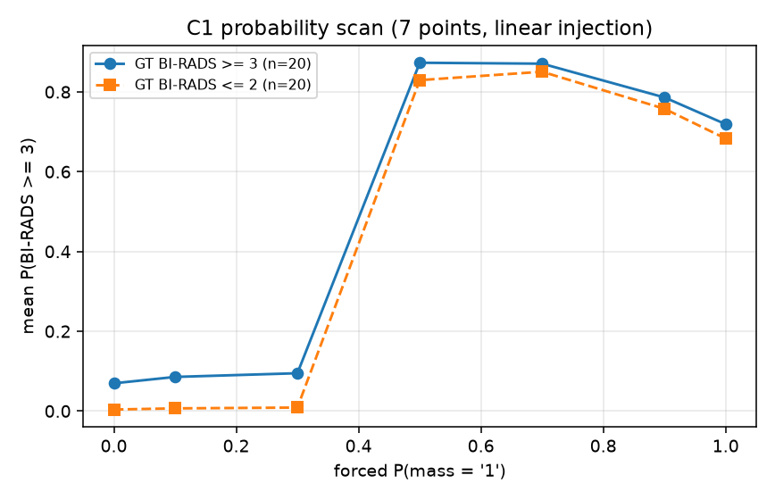

# 链条 v1 试验报告（阶段一 + 阶段二）

## 口径说明（必读）

- **C1、C2 使用 linear 注入**（(1−p)·E0 + p·E1，不用 mixer）：alpha=1, lam=1, rho_max=0.5, rho_warmup_frac=0.2, --no-reuse-embeds；C2 额外 --detach-p。
- 阶段一 QC1 用 logit_mlp（mixer）训练 50 步；其概率扫描**方向反向**（p=0→1 时 P(≥3) 由 0.5445 降到 0.4120）。归因于 **mixer**：训练 50 步后偏移达嵌入范数 1.0–3.6×，且 p→0 端最大（p=0.005 时 3.57×），淹没了该位置的语义。同一批乳房改用**硬 token** 注入时方向正确且强（GT≥3 组 0.2544→0.9152，GT≤2 组 0.1095→0.8858）。故阶段二改用 linear 注入。
- 所有评测统一 `eval_soft`、batch=1；B0 的 b8 结果仅作附表参考。

## 阶段一（最快版）

# 阶段一快报（机制验证）

**GATE: STOP**（QC1 扫描 p=0→1 的 P(≥3) 均值差 = -0.1324（需 >0.1））

## 开头三问

1. **概率扫描曲线**：起点模型 = deferred（起点扫描已挪到阶段二末，届时补图）；QC1 = **smooth**（max−min=0.184，最大单跳=0.098）；QC1 曲线 p=0→1 的 P(≥3) 均值差 = -0.1324。曲线图见 `quick_scan.png`。
2. **软一致性**（n=200，起点挑的 pred≤2 且 max_sign>0.1）：P(≥3) 中位数 起点 hard = 0.0003 → QC1 soft = **0.2408**（+0.2404）；Spearman(P(≥3), max_sign) 起点 = 0.507，QC1 = 0.717。
3. **软换硬**：QC1 同批乳房 soft P(≥3) 中位 = 0.2408 → 换成 argmax token 嵌入 = 0.1774（Δ = +0.0634，变化不大）。

## 数值明细

| 项 | 起点(1ep, hard) | QC1(50步, soft) |
|---|---|---|
| P(≥3) 中位数 | 0.0003 | 0.2408 |
| P(≥3) 与 max_sign 的 Spearman | 0.507 | 0.717 |
| 扫描曲线形状 (GT≥3) | deferred | smooth (range 0.184) |
| 扫描 P(=0)→P(=1) 的 P(≥3) 均值 (GT≥3) | deferred | 0.5445→0.4120（Δ=-0.1324） |
| 扫描 P(=0)→P(=1) 的 P(≥3) 均值 (GT≤2) | deferred | 0.3061→0.2042 |
| 软换硬 P(≥3) 中位数 | — | 0.1774 |

## 口径

- 起点模型 = `Qwen3.5-4B-lora-2view-os-sub-vt` 1 epoch（checkpoint-439）；QC1 = 该 adapter + 50 步软证据训练（logit_mlp, small, alpha=1, lam=1, rho_max=0.5, 无 warmup）。
- 软一致性批次：起点 hard 预测 ≤2 且 max 征象概率 >0.1 的前 200 个验证集乳房。
- 扫描：GT≥3 / GT≤2 各 50 个乳房，强制 mass 证据 p=0,0.1,…,1（其余征象按模型自身 p 注入）；起点模型无 mixer，用 linear 注入 (1−p)E0+pE1 做对照。
- GATE 判据（三条同时满足才 PASS，NaN/报错一律 STOP）：① QC1 扫描 p=0→1 的 P(≥3) 均值差 >0.1；② QC1 的 Spearman 比起点高 ≥0.1；③ QC1 的 P(≥3) 中位数高于起点。
- 起点扫描（5/5）已挪到阶段二末，用冻结代码从断点续跑；最终报告补起点 vs QC1 对比图。

## 确定样本上软注入的扰动

- 样本：GT BI-RADS=1 且起点模型 4 征象 p<0.05，val 取 100 例（QC1，batch=1）
- P(BI-RADS=1) 中位：软 0.8187 / 软换硬 0.8642
- |ΔP(BI-RADS=1)| 平均：0.0453（中位 0.0462，最大 0.0929）
- 预测 BI-RADS 不一致：0/100

## 阶段二（全量版）

# 链条 v1 全量试验报告（阶段二）

## 0. 结论表（验证集 1600 乳房）

| 组 | BI-RADS macroAUC | ≥3 AUC | macroF1 | acc | bACC | 密度 macroAUC | 征象 meanAUC | 硬矛盾 A/B | 软一致性 P(≥3) 中位 |
|---|---|---|---|---|---|---|---|---|---|
| B0 | 0.819 | 0.765 | 0.465 | 0.779 | 0.439 | 0.934 | 0.785 | 0/0 | 0.000 |
| C1 | 0.772 | 0.684 | 0.335 | 0.777 | 0.324 | 0.840 | 0.720 | 1/0 | 0.005 |
| C2 | 0.815 | 0.754 | 0.386 | 0.777 | 0.373 | 0.826 | 0.763 | 14/0 | 0.268 |
| Aligner | 0.818 | 0.770 | 0.440 | 0.775 | 0.426 | — | — | —/— | — |

B0 主要指标来源：soft_decode_hard（eval_soft 硬模式全量 1600，与 1-epoch b8 锚点核对一致）。

## 差值 bootstrap（study 级 1000 次，seed 42）

Δ = 后者 − 前者；`*` 表示 95% CI 不含 0。

| 指标 | C1-B0 | C2-B0 | C1-C2 | C1-Aligner |
|---|---|---|---|---|
| BI-RADS macroAUC | -0.048 [-0.069, -0.027]* | -0.004 [-0.021, +0.013] | -0.043 [-0.061, -0.026]* | -0.047 [-0.071, -0.025]* |
| ≥3 AUC | -0.081 [-0.112, -0.047]* | -0.011 [-0.038, +0.016] | -0.070 [-0.099, -0.042]* | -0.086 [-0.129, -0.044]* |
| macroF1 | -0.130 [-0.185, -0.072]* | -0.079 [-0.131, -0.025]* | -0.051 [-0.116, +0.011] | -0.104 [-0.160, -0.045]* |
| 灵敏度@特异度90% | -0.115 [-0.181, -0.028]* | +0.019 [-0.029, +0.080] | -0.134 [-0.200, -0.056]* | -0.108 [-0.195, -0.020]* |
| 灵敏度@特异度95% | -0.121 [-0.196, -0.053]* | +0.038 [-0.024, +0.084] | -0.159 [-0.227, -0.082]* | -0.127 [-0.208, -0.051]* |
| 密度 AUC | -0.094 [-0.114, -0.078]* | -0.108 [-0.132, -0.091]* | +0.014 [+0.004, +0.027]* | -0.094 [-0.114, -0.078]* |
| 征象 meanAUC | -0.065 [-0.104, -0.025]* | -0.022 [-0.046, +0.004] | -0.043 [-0.076, -0.008]* | -0.065 [-0.104, -0.025]* |

## 详细指标

见 `pilot_stage2_metrics.json`（全部数值：各类召回、特异度 90/95% 灵敏度、征象 AUC/F1、密度、老师模式、软换硬、bootstrap CI）。

---

## 附：指标修正、注入位置核查与密度下降归因（2026-10-25）

### A. 指标计算修正

- 修正 `pilot_metrics.py` 每类召回的计算 bug（原为 `mean([1…])/count` ≡ `1/count`），
  macroF1 / acc / bACC / 各类召回已按正确口径重算（B0 macroF1 0.465、bACC 0.439）。
- 1-epoch 锚点核对（`outputs/scoring/os_sub_vt_val_b8_with_probs.jsonl`，1600 例）：
  macroAUC 0.8071 / ≥3 AUC 0.7557 / macroF1 0.4323 / 密度 0.9337 / 征象 0.7897，
  与 B0（0.8191 / 0.7650 / 0.4650 / 0.9343 / 0.7853）差 0.01 量级 → 评测口径一致。
- bootstrap 改为**指标级**配对重采样（study 级 800、1000 次、seed 42），见上文差值表。

### B. 注入位置核查（训练与推理两条路径）

| 路径 | 注入位置 | 对应 token | 密度位置 |
|---|---|---|---|
| 训练（`SoftKDDataset`，3 样本） | `finding_pos=[16,26,34,44]` | 4 个征象取值 `"0"/"1"`（与 gt_findings 一致） | idx 6（"C"/"D"）**未命中** |
| 训练 | `birads_pos=54` | BI-RADS 取值（= gt_birads） | — |
| 推理（`c1_soft` 的 `soft_events`） | step=16/26/34/44 | 与训练位置完全相同 | idx 6 **未注入** |

代码层：`build_inputs()` 仅透传位置（`train/data.py:95-96`）；`soft_decode` 的注入触发为
`completed_finding_field(text, names)`，`names` 恒为 4 个征象 → 结构上不可能碰到密度。

### C. 硬模式 vs 软模式（同 400 乳房，`ids2_ablation.json`，batch=1）

| 组 | 密度 AUC（硬/软） | BI-RADS macroAUC | ≥3 AUC | 征象 meanAUC | macroF1 | 密度预测不一致 |
|---|---|---|---|---|---|---|
| C1 | 0.8772 / 0.8778（Δ+0.0006） | 0.7709 / 0.7716 | 0.6953 / 0.6916 | 0.7093 / 0.6985 | 0.3012 / 0.3012 | **2/400** |
| C2 | 0.8599 / 0.8599（Δ0.0000） | 0.8190 / 0.8233 | 0.7482 / 0.7540 | 0.7678 / 0.7568 | 0.3351 / 0.3469 | **0/400** |

### D. 结论

软注入对密度预测几乎无影响（C1 差 +0.0006、2 例翻转；C2 差 0、0 例翻转），
故全量上密度 AUC 由 B0 0.934 降到 C1 0.840 / C2 0.826 属于**训练本身造成的真实退化**，
而非软模式读数或注入位置错误。其余指标在硬/软之间的差异均在 ±0.012 内。
（注：该 400 子集未跑 B0，C1/C2 在此子集的 AUC 与全量不同，仅用于硬/软同批对照。）

---

## 附：训练过程指标（B0 / C1 / C2，逐步窗口平均）

数据来源：三组训练日志（`logging_steps=1`，指标为梯度累积窗口 = 16 个 micro-batch 的平均）。
日志解析到 **438 步**（step 0–437，最后一步未打印）。

### 1. 最后 50 步 ce1 均值

| 组 | 全部窗口 | 仅“跑了第二遍”的窗口 |
|---|---|---|
| B0（no-soft，无第二遍） | 0.02484 | — |
| C1（linear） | 0.03429 | 0.03429（50/50） |
| C2（linear + detach-p） | 0.03336 | 0.03336（50/50） |

注：`n_second` 在最后 50 步均值 **7.84 / 16**（min 4，max 11），即 16 个 micro-batch 里几乎每个窗口都至少有 1 个跑第二遍，
所以“仅第二遍窗口”与“全部窗口”在本数据上完全相同；但 ce2/kl 的窗口平均里含约一半未跑第二遍的 0 值。

### 2. C1 / C2 最后 50 步 ce2、kl 与比值（alpha = lam = 1）

| 组 | ce1 | ce2（窗口平均） | kl（窗口平均） | (ce2+kl)/ce1 | 折算到“跑了第二遍”的样本* | 折算后比值 |
|---|---|---|---|---|---|---|
| C1 | 0.03429 | 0.28442 | 0.02327 | **8.97** | ce2≈0.5804，kl≈0.0475 | **18.31** |
| C2 | 0.03336 | 0.43265 | 0.04925 | **14.45** | ce2≈0.8830，kl≈0.1005 | **29.48** |

\* 折算 = 窗口平均 ÷ 0.490（最后 50 步第二遍占比 7.84/16）。

**要点**：KD 项（α·ce2 + λ·kl）比 ce1 大一个数量级——C1 约 9×（折算后 18×），C2 约 14×（折算后 29×），
即训练后期主导梯度的是软证据蒸馏项而不是语言建模项；C2（detach-p）尤为突出，与它学成“近似常数偏移”的软证据一致。

### 3. 每 50 步 ce1 均值曲线

| 区间 | B0 | C1 | C2 |
|---|---|---|---|
| 1–50 | 0.13202 | 0.14307 | 0.14281 |
| 51–100 | 0.03191 | 0.04131 | 0.04000 |
| 101–150 | 0.02825 | 0.04149 | 0.03751 |
| 151–200 | 0.02741 | 0.03883 | 0.03598 |
| 201–250 | 0.02605 | 0.03471 | 0.03461 |
| 251–300 | 0.02376 | 0.03392 | 0.03251 |
| 301–350 | 0.02459 | 0.03428 | 0.03218 |
| 351–400 | 0.02509 | 0.03599 | 0.03424 |
| 401–438 | 0.02488 | 0.03485 | 0.03330 |

三组都在 50 步内快速下降到底部，之后平台化；C1/C2 的 ce1 全程比 B0 高约 0.008–0.012。

### 4. C1 概率扫描（7 点，40 例：GT≥3 / GT≤2 各 20）

数值（mean P(BI-RADS≥3)）：

| p | 0.0 | 0.1 | 0.3 | 0.5 | 0.7 | 0.9 | 1.0 |
|---|---|---|---|---|---|---|---|
| GT≥3 | 0.070 | 0.086 | 0.095 | 0.873 | 0.871 | 0.786 | 0.719 |
| GT≤2 | 0.004 | 0.007 | 0.009 | 0.829 | 0.851 | 0.758 | 0.683 |

方向正确（p=0→1 上升，GT≥3 Δ=+0.650、GT≤2 Δ=+0.679），跳变集中在 p≈0.3–0.5 之间，
即 linear 注入对 p 的响应是“阈值式”的——这与 `soft_mixer.py` 文档里对 linear 模式的描述一致。
