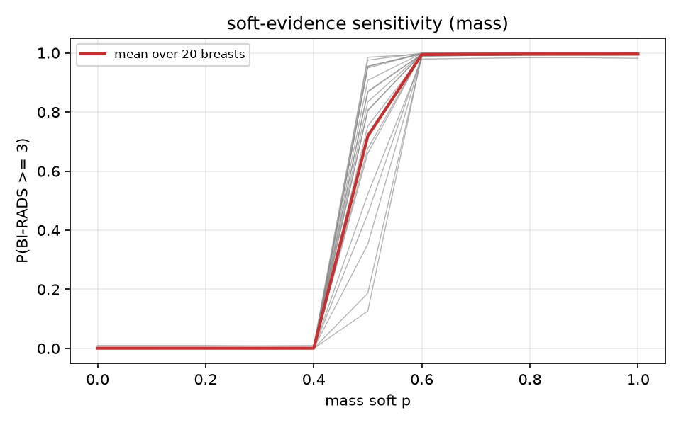

# 链条侧 v1 · 免训练软证据探针

模型：`Qwen3.5-4B-lora-2view-os-sub-vt`（1-epoch 解冻版），b8 流水线，图像预算 786432（每视角 756 token）。

## 1. 硬 token vs 软证据（BI-RADS 分布）

| split | n | 指标 | hard (b8 token) | soft (嵌入混合) |
|---|---|---|---|---|
| test | 2000 | BI-RADS macro OvR AUC | 0.806361 | 0.806169 |
| test | 2000 | >=3 AUC | 0.787308 | 0.788996 |
| val | 1600 | BI-RADS macro OvR AUC | 0.812084 | 0.809840 |
| val | 1600 | >=3 AUC | 0.758686 | 0.755947 |

## 2. 贪心 findings 全 0 子集

| split | n(全0) | hard >=3 AUC | soft >=3 AUC | hard 中位 P(>=3) 病灶/正常 | soft 中位 P(>=3) 病灶/正常 |
|---|---|---|---|---|---|
| test | 1896 | 0.696454 | 0.698644 | 0.000165 / 0.000086 | 0.000176 / 0.000086 |
| val | 1528 | 0.653590 | 0.649613 | 0.000168 / 0.000087 | 0.000168 / 0.000088 |

## 3. 敏感性（mass p: 0→1，20 个乳房）

| 指标 | 值 |
|---|---|
| 20 例整体 ΔP(>=3)（p=1 减 p=0）中位数 | 0.997231 |
| 同上最大值 | 0.999259 |
| 同上最小值 | 0.981798 |

## 4. 老师分布（正确征象作前缀）的组内区分

| split | 组 | n | 正/负 | AUC |
|---|---|---|---|---|
| test | only_mass | 90 | 34(4/5) / 56(gt3) | 0.602679 |
| test | only_calc | 20 | 16(4/5) / 4(gt3) | 0.671875 |
| test | all_zero | 1808 | 467(gt2) / 1341(gt1) | 0.837668 |
| val | only_mass | 77 | 36(4/5) / 41(gt3) | 0.559621 |
| val | only_calc | 16 | 11(4/5) / 5(gt3) | 0.581818 |
| val | all_zero | 1443 | 371(gt2) / 1072(gt1) | 0.867986 |
| test+val | only_mass | 167 | 70(4/5) / 97(gt3) | 0.577761 |
| test+val | only_calc | 36 | 27(4/5) / 9(gt3) | 0.633745 |
| test+val | all_zero | 3251 | 838(gt2) / 2413(gt1) | 0.851149 |

## 5. 自检：本脚本 hard 与 b8 记录的一致性

| split | n | argmax 一致率 | 平均绝对差（5 类逐样本平均后再平均） | 单例最大平均绝对差 |
|---|---|---|---|---|
| test | 2000 | 0.988500 | 0.007059 | 0.080647 |
| val | 1600 | 0.983125 | 0.007440 | 0.089480 |

## 6. 口径

- 软证据：b8 已记录的每个 finding 的 p=P(1)/(P(0)+P(1))；把生成 JSON 中 4 个 finding 取值 token 的输入嵌入替换为 (1−p)·E[0]+p·E[1]（在 decoder 第 0 层入口替换 hidden state，等价于替换输入嵌入），前向一次后取 BI-RADS 取值位置在 '1'..'5' 上的归一化分布。
- hard 为本脚本用同一份自生成 JSON、不替换嵌入时重算的 BI-RADS 概率；soft 的唯一差别是 4 个 finding 取值位置的输入嵌入被换成 (1−p)E[0]+pE[1]。b8 记录的概率仅用于提供 p 与自检。
- 组内区分用 GT 征象构成的前缀（teacher），BI-RADS 位置仍按模型分布读取。

