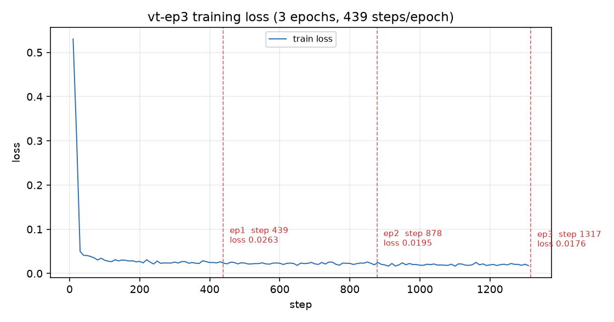

# vt-ep3 batch=8 评测报告

流水线: `infer_2view_batched.py` (batch=8, 生成时直接取字段概率) + `summarize_probs.py`; 测试集 `data/splits/test_local.json` (2000 条)。

## 1. 主表

| run | Density AUC | Density macro-F1 | Density bACC | BI-RADS AUC | BI-RADS macro-F1 | BI-RADS bACC | Findings AUROC | Findings macro-F1 | Findings bACC | any-finding AUC |
|---|---|---|---|---|---|---|---|---|---|---|
| 1-epoch (b8) | 0.9361 | 0.5318 | 0.5191 | 0.8040 | 0.4262 | 0.3991 | 0.8056 | 0.2495 | 0.6043 | 0.8107 |
| e1 (b8) | 0.9316 | 0.4967 | 0.4698 | 0.8283 | 0.4334 | 0.4216 | 0.8447 | 0.2352 | 0.5952 | 0.8379 |
| e2 (b8) | 0.9461 | 0.6071 | 0.5886 | 0.8437 | 0.4823 | 0.4777 | 0.8567 | 0.2863 | 0.6302 | 0.8518 |
| e3 (b8) | 0.9442 | 0.6058 | 0.5789 | 0.8495 | 0.5187 | 0.4947 | 0.8589 | 0.2863 | 0.6222 | 0.8552 |

> AUC = OvR macro AUC（density 4 类 / BI-RADS 5 类）、findings 为 4 个二分类 AUROC 的平均；macro-F1 / bACC 基于 probs argmax（findings 用 0.5 阈值，bACC 为 4 个 finding 的 (recall+specificity)/2 平均）。

## 2. 显著性：与 1-epoch (b8) 的配对 bootstrap 差值

study 级配对 bootstrap，1000 次，seed=42；差值为「该 run − 1-epoch」，单位 AUC；CI 不跨 0 标 `*`。

| run | Δ Density AUC [95% CI] | Δ BI-RADS AUC [95% CI] | Δ Findings AUROC [95% CI] |
|---|---|---|---|
| e1 (b8) | -0.0045 [-0.0100, 0.0006] | +0.0244 [0.0139, 0.0356] * | +0.0391 [0.0135, 0.0723] * |
| e2 (b8) | +0.0100 [0.0058, 0.0142] * | +0.0397 [0.0283, 0.0508] * | +0.0511 [0.0251, 0.0814] * |
| e3 (b8) | +0.0081 [0.0034, 0.0130] * | +0.0455 [0.0343, 0.0579] * | +0.0532 [0.0247, 0.0847] * |

## 3. 计数表（贪心输出的条数）

| 计数项 | 1-epoch (b8) | e1 (b8) | e2 (b8) | e3 (b8) |
|---|---|---|---|---|
| 密度 A 类：预测数 | 0 | 0 | 3 | 2 |
| 密度 A 类：预测且真实为 A | 0 | 0 | 1 | 1 |
| 有病灶乳房（GT 阳性）总数 | 192 | 192 | 192 | 192 |
| 有病灶乳房：检出（预测任一 finding 阳性） | 65 | 62 | 74 | 69 |
| finding mass：预测阳性数 | 88 | 86 | 91 | 80 |
| finding mass：预测阳性且真实阳性 | 46 | 47 | 52 | 48 |
| finding calcification：预测阳性数 | 33 | 29 | 47 | 40 |
| finding calcification：预测阳性且真实阳性 | 23 | 19 | 32 | 31 |
| finding asymmetry：预测阳性数 | 0 | 0 | 0 | 0 |
| finding asymmetry：预测阳性且真实阳性 | 0 | 0 | 0 | 0 |
| finding arch.distortion：预测阳性数 | 0 | 0 | 0 | 0 |
| finding arch.distortion：预测阳性且真实阳性 | 0 | 0 | 0 | 0 |
| BI-RADS 1：预测数 | 1704 | 1699 | 1632 | 1609 |
| BI-RADS 2：预测数 | 192 | 208 | 259 | 297 |
| BI-RADS 3：预测数 | 15 | 31 | 34 | 33 |
| BI-RADS 4：预测数 | 72 | 35 | 44 | 36 |
| BI-RADS 5：预测数 | 17 | 27 | 31 | 25 |

## 4. 训练 loss 曲线

| epoch | step | loss |
|---|---|---|
| 1 | 439 | 0.0263 |
| 2 | 878 | 0.0195 |
| 3 | 1317 | 0.0176 |

## 5. 结论

- e1/e2/e3 相对 1-epoch 的 9 个 AUC 差值中只有 8 个的 95% CI 不跨 0（e1 (b8) 2 个、e2 (b8) 3 个、e3 (b8) 3 个），其余差异不显著。
- 按三个字段 AUC 的平均值排序，最好的是 e3 (b8)（均值 0.8842），相对 1-epoch 的差值为 Density +0.0081、BI-RADS +0.0455、Findings +0.0532。
- macro-F1 / bACC 上 e1/e2/e3 至少一项相对 1-epoch 的差值 ≥ 2 个百分点。
- 继续训练只在部分字段上带来 AUC 变化，建议以 e3 (b8) 作为该 backbone 的最终选择。
